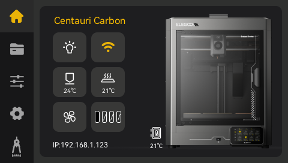
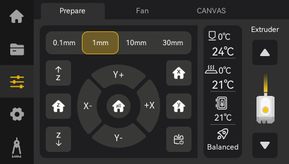
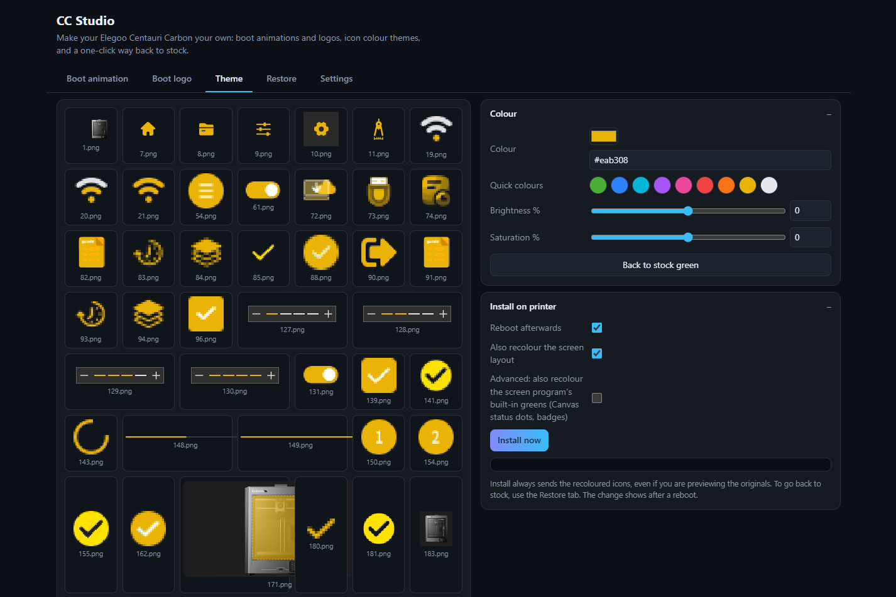

# CC Studio

Free Windows app that customises the **Elegoo Centauri Carbon** running **OpenCentauri**: your own boot animation and logo, a full colour theme for the touchscreen, and one-click restore to stock.

 

## Website
https://sawkymod.github.io/CCStudio/

## Download
Get the latest `CC-Studio-win64.zip` from the [Releases page](../../releases/latest), unzip it and run `CC Studio.exe`. Windows 10/11, no install. Your PC and printer must be on the same network.

## Features
- **Boot animation**: build the 100-frame animation (frames 1001-1100) from an MP4/GIF or pictures, with progress bar, effects and live preview. Ready-made animation included.
- **Boot logo**: any PNG/JPG converted to the printer's 24-bit 480x272 BMP. Ready-made logos included.
- **Colour theme**: recolours every stock green icon and the screen layout (so the Canvas page follows too). Optional advanced mode recolours colours built into the screen program (off by default).
- **Restore**: puts animation, icons, screen layout, screen program and logo back to stock.
- **Settings**: printer IP/user/password, Test connection, Fix, and a Screenshot button for the printer screen.

## Compatibility
Built and tested on one Centauri Carbon running OpenCentauri. The screen layout and screen program recolours only apply when the printer's file matches the stock version they were made for; on other firmware versions those parts are skipped safely, so you may get a partial recolour. The icon recolour, boot animation, boot logo and Restore don't depend on this.

## Safety
No firmware is flashed. Stock files stay in the printer's read-only layer; changes sit on top and can be removed. SSH runs separately from the touchscreen, so you can always connect and restore. The advanced screen-program patch checks the file fingerprint first and skips itself if it isn't the stock version.

Manual recovery over SSH: `cp /rom/app/app /app/.app.new && mv /app/.app.new /app/app && reboot`

## Disclaimer
Community project, not affiliated with Elegoo or OpenCentauri. Use at your own risk.
